<div align="center">

<a href="https://user-cariv.github.io/Donut/"></a>

<br/>

<a href="https://user-cariv.github.io/Donut/"><b>Website</b></a> &nbsp;·&nbsp;
<a href="#the-lineup"><b>Apps</b></a> &nbsp;·&nbsp;
<a href="#compare"><b>Compare</b></a> &nbsp;·&nbsp;
<a href="#tech-specs"><b>Tech Specs</b></a> &nbsp;·&nbsp;
<a href="https://user-cariv.github.io/Donut/#support"><b>Support</b></a> &nbsp;·&nbsp;
<a href="https://www.youtube.com/@Meet_Donut"><b>YouTube</b></a>

<br/><br/>


</div>

<br/>

<div align="center">

# Make room for<br/>what matters.

### Donut makes focused apps that take care of the little things,<br/>so you can get back to the work and life that matters.

<br/>

<sub>◐ &nbsp; LESS NOISE &nbsp;·&nbsp; MORE FLOW &nbsp; ◑</sub>

</div>

<br/><br/>

---

<br/>

<div align="center">

## The Lineup

<sub>Pick a Donut app and make your everyday workflow a little lighter.</sub>

<br/><br/>

<a href="https://user-cariv.github.io/Donut/convert.html"></a>

<a href="https://user-cariv.github.io/Donut/island.html"></a>

<a href="https://user-cariv.github.io/Donut/boost.html"></a>

</div>

<br/>

---

<br/>

<div align="center">

## Compare

<sub>Find the Donut that fits your day.</sub>

<br/>

<table>
<tr>
<th></th>
<th align="center">🔄<br/><b>Convert</b></th>
<th align="center">🏝️<br/><b>Island</b></th>
<th align="center">🚀<br/><b>Boost</b></th>
</tr>
<tr>
<td><b>What it does</b></td>
<td align="center">Converts images and documents</td>
<td align="center">Notifications, calls, events</td>
<td align="center">Faster downloads</td>
</tr>
<tr>
<td><b>Windows</b></td>
<td align="center">✅</td>
<td align="center">—</td>
<td align="center">✅</td>
</tr>
<tr>
<td><b>macOS</b></td>
<td align="center">✅</td>
<td align="center">✅</td>
<td align="center"><sub>Coming soon</sub></td>
</tr>
<tr>
<td><b>Works locally</b></td>
<td align="center">✅</td>
<td align="center">✅</td>
<td align="center">✅</td>
</tr>
<tr>
<td><b>Status</b></td>
<td align="center"><b>Available now</b></td>
<td align="center">For macOS</td>
<td align="center">Windows available</td>
</tr>
</table>

</div>

<br/>

---

<br/>

<div align="center">

## ✦ Why Donut

<br/>

<table>
<tr>
<td width="25%" align="center" valign="top">

### 🎯
**Focused**<br/>
<sub>One app.<br/>One job.<br/>Done well.</sub>

</td>
<td width="25%" align="center" valign="top">

### 🔒
**Private**<br/>
<sub>Local-first.<br/>Your files<br/>stay yours.</sub>

</td>
<td width="25%" align="center" valign="top">

### 🧘
**Calm**<br/>
<sub>No clutter.<br/>No nagging.<br/>Just flow.</sub>

</td>
<td width="25%" align="center" valign="top">

### ✨
**Beautiful**<br/>
<sub>Useful should<br/>feel beautiful.</sub>

</td>
</tr>
</table>

</div>

<br/>

---

<br/>

<div align="center">

## Tech Specs

<sub>Under the hood.</sub>

<br/>


</div>

<br/>

<details>
<summary><b>📁 &nbsp;Repository layout</b></summary>

<br/>

```text
Donut/
├── Donut Island/             # Donut Island
├── Mac OS/Donut/             # macOS app
├── Windows/                  # Windows apps
├── android/                  # Android
├── Website/                  # Donut website
├── src/  public/  scripts/   # Shared source, assets, tooling
├── supabase/                 # Support ticket backend
├── signpath/                 # Code signing setup
├── .github/workflows/        # CI/CD
├── assets/                   # README artwork
├── .env.example              # Environment template
├── CODE_SIGNING_POLICY.md    # How releases are signed
├── THIRD-PARTY-NOTICES.md    # Open-source attributions
└── LICENSE
```

</details>

<details>
<summary><b>🛠️ &nbsp;Run it yourself</b></summary>

<br/>

```bash
git clone https://github.com/user-cariv/Donut.git
cd Donut
cp .env.example .env
```

Each app lives in its own folder. Open the one you want for its build steps.

</details>

<details>
<summary><b>💬 &nbsp;Get help</b></summary>

<br/>

Head to the [support page](https://user-cariv.github.io/Donut/#support) or [open an issue](https://github.com/user-cariv/Donut/issues). Tell us what happened and the best email to reach you.

</details>

<details>
<summary><b>⚖️ &nbsp;Legal</b></summary>

<br/>

- [License](LICENSE)
- [Code Signing Policy](CODE_SIGNING_POLICY.md)
- [Third-Party Notices](THIRD-PARTY-NOTICES.md)

</details>

<br/>

---

<br/>

<div align="center">


### Small apps. Big relief.

<sub>Designed and built by <a href="https://github.com/user-cariv">Ariv R Choudhary</a> &nbsp;·&nbsp; © 2026 Donut</sub>

<br/>

<a href="https://user-cariv.github.io/Donut/">Website</a> &nbsp;·&nbsp;
<a href="https://www.youtube.com/@Meet_Donut">YouTube</a> &nbsp;·&nbsp;
<a href="https://user-cariv.github.io/Donut/#support">Support</a>

</div>
